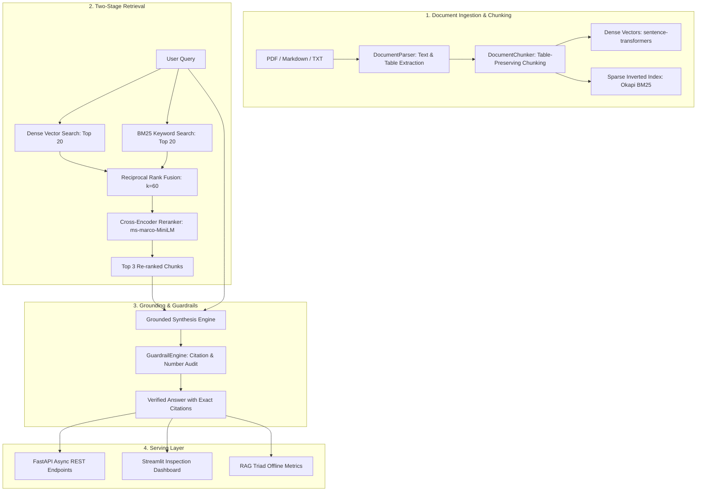

# InsightRAG

Enterprise Multimodal Retrieval-Augmented Generation (RAG) platform with hybrid dense-sparse search, reciprocal rank fusion (RRF), cross-encoder re-ranking, and citation-level guardrails.

---

## Overview

In enterprise production settings, naive vector search implementations frequently encounter three failure modes:
1. **Loss of Table Geometry:** Arbitrary token/character splitting destroys structured rows in financial filings, balance sheets, and engineering specs.
2. **Vocabulary Mismatch & Acronym Blindness:** Dense embedding models often fail to isolate exact part numbers, ticker codes, and domain acronyms.
3. **Ungrounded Hallucinations:** Answers delivered without explicit, page-level citation auditing introduce compliance and legal liability.

InsightRAG addresses these challenges through a modular two-stage retrieval pipeline combined with deterministic verification guardrails.

---

## Architecture



---

## Design Decisions

### Reciprocal Rank Fusion (RRF)
Rather than attempting linear score normalization between unbounded BM25 scores $[0, \infty)$ and bounded cosine similarities $[0, 1]$, InsightRAG merges candidate lists via rank positions:

$$\text{RRF\_Score}(d) = \sum_{m \in M} \frac{1}{k + r_m(d)}$$

Where $k = 60$ (Cormack et al., SIGIR 2009). This ensures robust candidate pooling without manual score calibration.

### Two-Stage Retrieval
- **First Stage (Retrieval):** Hybrid pooling retrieves 15-20 candidates under 10ms.
- **Second Stage (Re-ranking):** Cross-attention via `cross-encoder/ms-marco-MiniLM-L-6-v2` re-ranks candidates to select the final context window sent to the LLM.

### Citation Auditing & Hallucination Guardrails
- **Source Verification:** Every cited tag (`[Doc: <name>, Page: <page>]`) is checked against the actual retrieved context chunks.
- **Quantitative Audit:** Regular expressions extract currencies, percentages, and metrics to detect numerical assertions absent from source context.

---

## Directory Layout

```text
.
├── Dockerfile
├── docker-compose.yml
├── requirements.txt
├── .env.example
├── README.md
├── run_checks.py                  # Component validation script
├── data/
│   ├── sample_docs/              # Reference enterprise reports (Novacorp FY24 10-K)
│   └── index/                    # Persistent vector storage
├── src/
│   ├── config.py                 # Pydantic Settings
│   ├── ingestion/
│   │   ├── parser.py             # Layout-aware parser & markdown table builder
│   │   └── chunker.py            # Hierarchical & table-preserving chunker
│   ├── retrieval/
│   │   ├── dense.py              # ChromaDB vector store wrapper
│   │   ├── sparse.py             # Okapi BM25 implementation
│   │   ├── hybrid.py             # Reciprocal Rank Fusion retriever
│   │   └── reranker.py           # Cross-encoder re-ranking module
│   ├── generation/
│   │   ├── generator.py          # Grounded synthesis dispatch
│   │   └── guardrails.py         # Citation & numeric auditing
│   ├── evaluation/
│   │   └── metrics.py            # RAG Triad implementation
│   └── app/
│       ├── pipeline.py           # End-to-end orchestrator
│       ├── api.py                # FastAPI REST endpoints
│       └── ui.py                 # Streamlit diagnostic UI
└── tests/
    ├── test_ingestion.py
    ├── test_retrieval.py
    ├── test_guardrails.py
    └── test_pipeline.py
```

---

## Quickstart

### 1. Environment Setup

```bash
python -m venv .venv
# Windows:
.\.venv\Scripts\Activate.ps1
# Linux/macOS:
# source .venv/bin/activate

pip install -r requirements.txt
cp .env.example .env
```

### 2. Run Verification Checks

```bash
python run_checks.py
```

### 3. Launch the Streamlit Dashboard

```bash
streamlit run src/app/ui.py
```
Access at `http://localhost:8501`.

### 4. Run FastAPI Backend

```bash
uvicorn src.app.api:app --host 0.0.0.0 --port 8000 --reload
```
Interactive API documentation is served at `http://localhost:8000/docs`.

---

## API Reference

### Document Ingestion
`POST /api/v1/ingest`
- Consumes `multipart/form-data` with document payload (`.pdf`, `.txt`, `.md`).
- Returns extracted block count, index latency, and generated chunk metadata.

### Query & Insight
`POST /api/v1/query`
```json
{
  "query": "What was the total Cloud revenue in FY2024 and operating margin?",
  "top_k_candidates": 10,
  "top_k_final": 3
}
```

Response schema:
```json
{
  "query": "What was the total Cloud revenue in FY2024 and operating margin?",
  "answer": "Cloud Infrastructure & AI revenue reached $12,450 million in FY2024 with 35.3% growth. [Doc: novacorp_annual_report_fy2024.md, Page: 1]",
  "citations": [
    {
      "doc_id": "novacorp_annual_report_fy2024",
      "page_number": 1,
      "source_file": "novacorp_annual_report_fy2024.md",
      "snippet": "..."
    }
  ],
  "guardrail": {
    "passed": true,
    "faithfulness_score": 1.0,
    "verified_citations": 1,
    "unverified_citations": 0,
    "hallucinated_numbers": [],
    "warnings": []
  },
  "evaluation": {
    "context_relevance": 1.0,
    "groundedness": 1.0,
    "answer_relevance": 1.0,
    "composite_rag_score": 1.0
  },
  "latency_breakdown_ms": {
    "hybrid_retrieval_ms": 3.8,
    "reranking_ms": 1.9,
    "generation_ms": 3.2,
    "guardrails_ms": 1.1,
    "evaluation_ms": 0.7
  },
  "total_latency_ms": 10.7
}
```

---

## Testing

```bash
pytest tests/ -v
```

---

## Docker Deployment

```bash
docker-compose up --build
```
API: `http://localhost:8000` | UI: `http://localhost:8501`

---

## License
MIT
